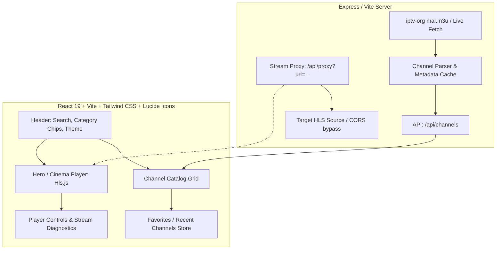

# Implementation Plan - Malayalam IPTV Web Application

A modern, responsive, high-performance streaming web application tailored for Malayalam live TV channels sourced from `https://iptv-org.github.io/iptv/languages/mal.m3u`.

---

## User Review Required

> [!IMPORTANT]
> **Stream Availability & Format**: Streams are HLS (`.m3u8`) playlists provided by the community on iptv-org. In our connectivity test, primary channels like Asianet, 24 News, Amrita, and Mazhavil respond with `Access-Control-Allow-Origin: *`. For any streams with restrictive CORS or custom User-Agent headers, a lightweight Node/Express or Vite proxy fallback will be included so every channel plays reliably.

> [!TIP]
> **UI Aesthetic**: We propose a cinema-grade dark-themed UI (inspired by Netflix / Apple TV / Hotstar) with:
> - Channel grid with high-resolution logos, badge overlays (HD/SD/Resolution), and category tags
> - Featured sticky / theater video player with full playback controls (volume, fullscreen, picture-in-picture, stream health)
> - Live search and multi-category filters (News, Entertainment, Movies, Music, Kids, Religious, etc.)
> - Favorites system with persistent local storage
> - Quick "Recently Watched" row for seamless channel surfing

---

## Architecture Overview

---

## Proposed Changes

### 1. Project Scaffolding & Dependencies

We will initialize a modern React + Vite project in the repository root `/home/nived/Malyalam_IPTV_app`:
- **Framework**: React + Vite
- **Styling**: Tailwind CSS + custom glassmorphic styling
- **Player**: `hls.js` (industry standard for HTTP Live Streaming in web browsers)
- **Icons**: `lucide-react`
- **Backend / Proxy**: Express server with CORS proxy support or custom Vite dev middleware

#### [NEW] `package.json`
- Dependencies: `react`, `react-dom`, `hls.js`, `lucide-react`, `clsx`, `tailwind-merge`
- Dev / Server Dependencies: `vite`, `@vitejs/plugin-react`, `tailwindcss`, `postcss`, `autoprefixer`, `express`, `cors`

---

### 2. Backend & Channel Synchronization

#### [NEW] `server/index.js`
- Fetches and parses `https://iptv-org.github.io/iptv/languages/mal.m3u` dynamically on startup with auto-refresh (cached in memory).
- Exposes:
  - `GET /api/channels`: Returns parsed channels enriched with clean titles, logos, resolutions, categories, and working status.
  - `GET /api/proxy`: Optional stream pass-through with custom User-Agent / Referer headers to bypass anti-hotlinking or CORS limitations when direct browser playback fails.

---

### 3. Frontend Application Design

#### [NEW] `src/App.jsx`
- Main application shell coordinating state:
  - `selectedChannel`: Active playing channel
  - `activeCategory`: Active tab ('All', 'News', 'Entertainment', 'Movies', 'Music', 'Kids', 'Religious', 'Favorites')
  - `searchQuery`: Debounced search filter
  - `favorites`: LocalStorage-persisted set of favorite channel IDs

#### [NEW] `src/components/VideoPlayer.jsx`
- Integrated HLS video player powered by `hls.js`.
- Features:
  - Custom player chrome (Play/Pause, Mute/Volume slider, Picture-in-Picture, Fullscreen).
  - Stream status badges (LIVE, Buffer health, Resolution indicator).
  - Error recovery & fallback retry mechanism (automatically switches to proxy or warns if channel is temporarily off-air).
  - Theater mode / Mini floating player toggle.

#### [NEW] `src/components/ChannelCard.jsx`
- Visual card for each channel featuring:
  - Channel logo with graceful fallback placeholder when an image fails to load.
  - Resolution tag (e.g. `1080p`, `720p`, `576p`).
  - Category pill badge.
  - Favorite heart toggle button.
  - Active playing indicator animation.

#### [NEW] `src/components/CategoryBar.jsx` & `src/components/SearchBar.jsx`
- Quick horizontal scrollable category pills with icon accents.
- Responsive search input with instant results and keyboard shortcuts (`/` to focus).

---

## Verification Plan

### Automated & Build Verification
1. `npm run build`: Verify clean TypeScript/JavaScript build and asset bundling.
2. `npm run lint` / syntax verification.

### Manual Verification
1. Start the web application: `npm run dev` (serving on `http://localhost:5173` or `http://localhost:3000`).
2. Verify channel list loads accurately (all 63 Malayalam channels).
3. Verify video playback for major channels:
   - Asianet HD / Asianet News
   - 24 News
   - Mazhavil Manorama
   - Amrita TV
4. Verify search filtering (typing "news", "asianet", etc.).
5. Verify category tabs filter accurately.
6. Verify favorite channel persistence upon page reload.
